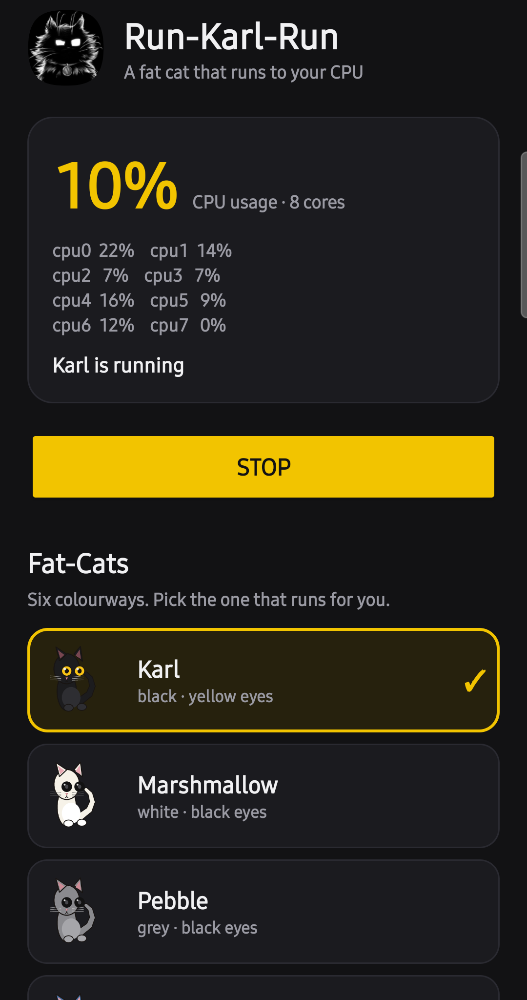

# Run-Karl-Run

A fat cat that runs to your CPU.

The cat lives in your status bar and runs faster as your phone works harder. Open
the app and you get the numbers behind the animation: overall CPU usage and a
per-core breakdown, live.

No ads. No trackers. No network permission at all — the app cannot reach the
internet, so there is nothing to send anywhere.



## What it does

- **Status-bar cat.** A foreground service keeps a small cat icon in the status
  bar and redraws it frame by frame. Its stride is a continuous function of real
  CPU usage, so the speed tracks the load instead of stepping between gears.
- **Live CPU readout.** While the app is open it polls once a second and shows
  the overall percentage, the core count, and every core's own percentage. The
  service behind the cat samples every 400 ms and smooths the result, which is
  what makes the animation responsive.
- **Six Fat-Cats.** Pick the one that runs for you. They are the same cat in
  different colourways, and the one you pick is what appears in the notification
  shade at full size.

| Fat-Cat | Colourway |
|---|---|
| **Karl** | black · yellow eyes |
| Marshmallow | white · black eyes |
| Pebble | grey · black eyes |
| Blueberry | blue · yellow eyes |
| Pumpkin | orange · yellow eyes |
| Patches | calico · yellow eyes |

The status-bar icon itself is tinted to a single colour by Android — that is the
platform's rule for small icons, not a limitation of the app — so the colourways
show in the app and as the large icon in the shade.

## How the speed follows the load

The stride — one full leg cycle — is mapped straight from CPU load: **2.1 s at
idle down to 0.45 s with the CPU pegged**, linearly, so 50% load lands at 1.33 s.
There are no gears and no deadband. The percentage in the text and the speed of
the cat are the same number, which was not true of the five-gear version this
replaces — that one could sit at "walk" while the CPU read 100%.

The pose is **derived from elapsed time**, not counted out per update:

```
phase   += elapsed / (2 * stride)          // 0..1, one full 12-frame loop
frame    = floor(phase * 12)               // which of the twelve poses
interval = clamp(stride * 2 / 6, 300, 700) // how often to post
```

Two things follow from deriving the pose instead of accumulating it.

**The stride is exact.** With an integer "advance N poses per update", the stride
can only ever be a whole number of update intervals long, so a 2.1 s walk and a
0.45 s sprint cannot both be hit — every change of N made the cat lurch, and the
old table could not get below 0.9 s at full load at all. Deriving the pose from
the clock makes the stride whatever the curve asks for, and only the *cadence* is
quantised.

**A dropped update self-corrects.** If the platform sheds a post, the next one
simply shows the pose the clock has reached. Nothing drifts, and nothing has to
be caught up.

The post interval is then a free choice, picked for smoothness: two poses per
update, which is the animation convention "on twos", until the platform floor
stops it.

| load | stride | update every | updates/s | poses/update | gait |
|---|---|---|---|---|---|
| idle | 2.20 s | 700 ms | 1.4 | 2 | walk |
| 20% | 1.85 s | 616 ms | 1.6 | 2 | walk |
| 40% | 1.50 s | 500 ms | 2.0 | 2 | trot |
| 50% | 1.33 s | 441 ms | 2.3 | 2 | trot |
| 60% | 1.15 s | 383 ms | 2.6 | 2 | trot |
| 70% | 0.98 s | 325 ms | 3.1 | 2 | canter |
| 80% | 0.80 s | 300 ms | 3.3 | 2.3 | canter |
| 90% | 0.63 s | 300 ms | 3.3 | 2.9 | gallop |
| 100% | 0.45 s | 300 ms | 3.3 | 4 | **bolt** |

The cadence rises monotonically from 1.4 to 3.3 updates a second and never dips;
the number of poses per update only grows once the stride has become too short to
show two poses within the 300 ms floor.

**0.45 s is 2.2 strides a second, which is a galloping cat.** It is not faster for
a structural reason rather than by taste: the platform will not deliver an update
faster than one per 300 ms, and at 450 ms a stride is only one and a half updates
long. Go much below that and the cat is showing two poses and no motion.

The art is **twelve poses: two six-pose strides**, with the lead legs swapped
between them. One twelve-pose stride was the earlier design and it animated
smoothly, but it had no left/right alternation, so a stride could only be drawn
by three or more poses — which is where the old 0.9 s "walk at full load" floor
came from.

The load reading is smoothed (a ~0.5 s time constant over 400 ms samples) and it
is the same figure the text prints. An earlier version sampled once a second and
stepped through gears with a deadband; it lagged the load in both directions, and
at 100% it still walked.

Measured on a Galaxy A26 5G (Android 16), notification counters before and after:

| state | enqueued | delivered | shed |
|---|---|---|---|
| idle | 1.64/s | 1.64/s | 0 |
| pegged (8 × `yes`) | 3.21/s | 3.21/s | **0** |
| 5 s after release | 1.63/s | 1.63/s | 0 |

The screen agrees. Recording the status bar with `screenrecord` at full load and
reading the compositor's own frames gives a median pose change of **300 ms**
(3.30 poses/s), cycling through three poses. Three poses every 900 ms is one
twelve-frame loop, i.e. two strides, so the stride **as rendered** is 450 ms —
the figure the curve asks for, not just the figure it intends.

## How CPU is measured

Mostly from `/proc/stat`, using deltas of the per-core `cpuN` lines between
samples. Some Android builds deny apps that file, so there is a fallback that
reads the kernel's per-core cpuidle residency counters and turns idle time into
usage. Whichever path is live, the number on screen and the cat's gait come from
the same sample, so they always agree.

## The platform limit that shaped the animation

Android caps notification updates per package at about **3.5 per second** and
**drops** the excess rather than queueing it. A dropped update is a pose the
screen never shows, so posting too fast does not make the cat faster — it makes
it stutter.

The exact shape of that cap is in AOSP, and it is not a plain "5 posts in the
last second". `android.service.notification.RateEstimator` keeps an exponentially
weighted average of the gap between enqueues (alpha 0.7) and
`NotificationManagerService` compares `1 / rate` against a limit of 5. The check
runs *after* the estimate has already been updated for the update being tested —
`registerEnqueuedByAppAndAccepted()` is called early in
`enqueueNotificationInternal()`, the rate check is later in `postNotification()` —
so the "time since the last event" term is ~0 and the test collapses to

```
1 / (0.7 * average_gap) > 5      <=>      average_gap < 285.7 ms
```

Anything faster than roughly 3.5 updates a second gets shed. Measured on a
Galaxy A26 5G running Android 16:

| cadence | asked for | delivered | shed |
|---|---|---|---|
| 270 ms | 3.70/s | 1.35/s | **62%** |
| 300 ms | 3.33/s | 3.14/s | 1.3–2.9% |
| 320 ms | 3.13/s | 3.13/s | 0% |

So 300 ms is the floor, and that floor is why the fast gaits advance more than
one pose per update. The remaining 1–3% at 300 ms is jitter pushing individual
gaps under the threshold; it is a skipped pose every few seconds, not a stutter.

## Permissions

```
android.permission.POST_NOTIFICATIONS
android.permission.FOREGROUND_SERVICE
android.permission.FOREGROUND_SERVICE_SPECIAL_USE
```

That is the whole list. **No `INTERNET`, no `READ_*`, no `WRITE_*`, no location,
no analytics, no ad SDK.** The source link in the app opens your browser; the app
cannot open a socket itself.

Stopping matters and is easy: the STOP button in the app, or the Stop action on
the notification. Nothing restarts itself.

## Build

No Gradle, no AndroidX — a plain framework app built with the SDK tools:

```sh
# needs: a JDK, and Android SDK build-tools + platform android-36
RUNKARL_KS=/path/to/your.jks RUNKARL_KS_PASS=/path/to/password-file ./build.sh
```

`RUNKARL_KS_PASS` is the path to a file holding the keystore password, not the
password itself. There is no default keystore path, on purpose: a clone cannot
accidentally sign as this project.

`build.sh` runs `aapt2 → javac → d8 → zipalign → apksigner` and writes
`dist/RunKarlRun-1.2.apk`. The art in `app/src/main/res/` is generated by
`art/gen_art.py` from `art/ghost-karl.jpeg`; `art/preview/sheet.png` shows the
whole set at a glance.

## Install

Download the APK from [Releases](../../releases) and open it. Android will warn
about installing from outside the Play Store — that is expected for an unsigned-
by-Google build. Android 13+ will ask for notification permission on first run;
without it the cat has no status bar to run in.

## Verify your download

Every release carries a `SHA256SUMS` file, so you can check that what arrived is
what was published:

```sh
sha256sum -c SHA256SUMS
# RunKarlRun-1.2.apk: OK
```

The APK is signed with a dedicated release key. To see who signed it:

```sh
apksigner verify --print-certs RunKarlRun-1.2.apk | grep 'SHA-256 digest'
# 1b9dadc450396f5afabebdbb7f5eba6d628dd811d630c7156a9e709326acf6bc
```

If that digest is not exactly the line above, the file was not signed by this
project and should not be installed. Full details of the signing identity, and
what it means for updates, are in [SIGNING.md](SIGNING.md).

## Licence

MIT — see [LICENSE](LICENSE).

This is an independent, clean-room app. It is not affiliated with, derived from,
or endorsed by any other cat-on-a-status-bar app.
